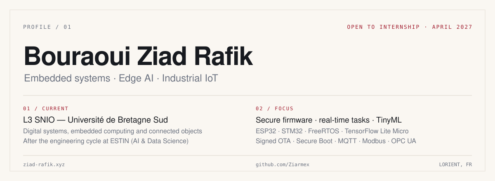

<!-- Profile README · Bouraoui Ziad Rafik · rev. 2026.10 -->

<picture>
  <source media="(prefers-color-scheme: dark)" srcset="./assets/banner-dark.svg">
  <source media="(prefers-color-scheme: light)" srcset="./assets/banner-light.svg">
  
</picture>

  <a href="https://ziad-rafik.xyz"><b>Portfolio</b></a>&nbsp;&nbsp;·&nbsp;&nbsp;
  <a href="mailto:ziad.r.bouraoui@gmail.com"><b>Email</b></a>&nbsp;&nbsp;·&nbsp;&nbsp;
  <a href="https://github.com/Ziarmex?tab=repositories"><b>Repositories</b></a>

 

### 01 &nbsp;Profile

I'm a computer engineering student in the L3 SNIO programme (digital systems, embedded computing and connected objects) at Université de Bretagne Sud, France, after the engineering cycle in AI & Data Science at ESTIN, Algeria. I build connected systems end to end: bare-metal firmware, real-time tasks, secure update paths and the dashboards that show what the device is doing.

The part I care about is the layer where software meets hardware: making a device trustworthy, measurable and maintainable in the field, not just on the bench.

 

### 02 &nbsp;Selected work

**Secure OTA for ESP32** &nbsp;2026 · ESP-IDF, C, Secure Boot v2, TLS/PKI

<table>
  <tr>
    <td width="130" valign="top">CONTEXT</td>
    <td>Firmware updates for fielded devices must be signed, version-gated, and recoverable when the new image is bad.</td>
  </tr>
  <tr>
    <td valign="top">CONTRIBUTION</td>
    <td>Secure Boot v2 (RSA-3072 / RSA-PSS), AES-256 flash encryption, signed HTTPS OTA, anti-rollback and automatic rollback after a failed self-test. Release tooling signs the image and emits a SHA-256 manifest.</td>
  </tr>
  <tr>
    <td valign="top">OUTCOME</td>
    <td>10/10 host tests for manifest and PKI. Two build configurations: development and Secure Boot + flash encryption. <a href="https://github.com/Ziarmex/esp32-secure-ota">Source</a>.</td>
  </tr>
</table>

**FreeRTOS multi-sensor node** &nbsp;2026 · STM32L476, CMSIS-RTOS2, I2C, C

<table>
  <tr>
    <td width="130" valign="top">CONTEXT</td>
    <td>A super-loop that reads I2C, computes statistics and prints over UART couples a fast sensor to a slow console. One blocking print destroys the sample period.</td>
  </tr>
  <tr>
    <td valign="top">CONTRIBUTION</td>
    <td>Three fixed-priority tasks decoupled by queues (acquisition > processing > console), a pure-C ring-buffer core, DWT microsecond timestamps for latency and jitter, and tickless-idle low power.</td>
  </tr>
  <tr>
    <td valign="top">OUTCOME</td>
    <td>6/6 host tests on the statistics core. Board latency and power measurements are pending hardware. <a href="https://github.com/Ziarmex/freertos-sensor-node">Source</a>.</td>
  </tr>
</table>

**TinyML benchmark: float vs int8** &nbsp;2026 · TensorFlow Lite, ESP32, Python

<table>
  <tr>
    <td width="130" valign="top">CONTEXT</td>
    <td>Edge-AI claims usually quote accuracy with no model size, latency, RAM or method, which makes the trade-off unverifiable.</td>
  </tr>
  <tr>
    <td valign="top">CONTRIBUTION</td>
    <td>A reproducible harness that trains an autoencoder, exports float32, int8 PTQ and int8 QAT, then benchmarks every model on the host and on an ESP32. Results live in JSON and the README table is generated from it.</td>
  </tr>
  <tr>
    <td valign="top">OUTCOME</td>
    <td>24.8 KB → 13.5 KB → 10.3 KB; 97.1% / 97.4% / 97.0% on the synthetic set; 14/14 tests. <a href="https://github.com/Ziarmex/tinyml-bench">Source</a>.</td>
  </tr>
</table>

Also on my GitHub: <a href="https://github.com/Ziarmex/plc-gateway">plc-gateway</a> · <a href="https://github.com/Ziarmex/edge-pdm">edge-pdm</a> · <a href="https://github.com/Ziarmex/mini-plant">mini-plant</a> · <a href="https://github.com/Ziarmex/monitoring-stack">monitoring-stack</a> · <a href="https://github.com/Ziarmex/phone-server">phone-server</a>.

 

### 03 &nbsp;Experience & education

| Period | Role | Organisation |
| :-- | :-- | :-- |
| 2026 – 2027 | L3 SNIO — digital systems, embedded computing and connected objects | Université de Bretagne Sud, Lorient |
| Jun – Jul 2025 | IT intern, information systems | Sonelgaz, Jijel |
| 2022 – 2026 | Engineering cycle, AI & Data Science | ESTIN, Algeria |
| 2022 | Baccalaureate, Experimental Sciences — 16.87/20 | Very Good honor |

**Certifications:** TCF C2 (September 2025) · IELTS Academic 8.0 (August 2026).
**Languages:** Arabic (native), French (C2), English (IELTS 8.0).

 

### 04 &nbsp;Working together

I'm looking for a **2–3 month embedded / edge-AI internship starting April 2027**, in France or internationally, in English or French. What I can take on immediately:

- firmware and RTOS work on ESP32 and STM32
- secure update paths: Secure Boot, signed OTA, rollback
- TinyML measurement: model size, latency, RAM and accuracy
- industrial data plumbing: MQTT, Modbus, OPC UA, dashboards

The internship is required by my degree and covered by a convention with Université de Bretagne Sud. Outside France, the X2 student visa route with an invitation letter covers up to 180 days.

 

### 05 &nbsp;Toolkit

| Layer | Primary | Also used |
| :-- | :-- | :-- |
| Firmware | C, C++, ESP-IDF, STM32 HAL, CMSIS-RTOS2 / FreeRTOS | I2C, SPI, UART, DWT timing |
| Edge AI | TensorFlow Lite Micro, int8 PTQ / QAT, FFT features | scikit-learn, pandas, NumPy |
| Industrial IoT | MQTT, Modbus (TCP/RTU), OPC UA, Node-RED | OpenPLC |
| Data & dashboards | InfluxDB, Grafana, Prometheus | MongoDB, Flux |
| Delivery | Docker, Git, Linux, CI, Bash | TypeScript, React, Next.js |

 

### 06 &nbsp;Activity

<picture>
  <source media="(prefers-color-scheme: dark)" srcset="https://raw.githubusercontent.com/Ziarmex/Ziarmex/output/snake-dark.svg">
  <source media="(prefers-color-scheme: light)" srcset="https://raw.githubusercontent.com/Ziarmex/Ziarmex/output/snake.svg">
  
</picture>

Contribution graph, redrawn daily.

  

---

  Looking for an embedded / edge-AI intern for April 2027? Write to <a href="mailto:ziad.r.bouraoui@gmail.com">ziad.r.bouraoui@gmail.com</a> with the team and the problem.
    
  Sheet 01 of 01 · Rev. 2026.10

